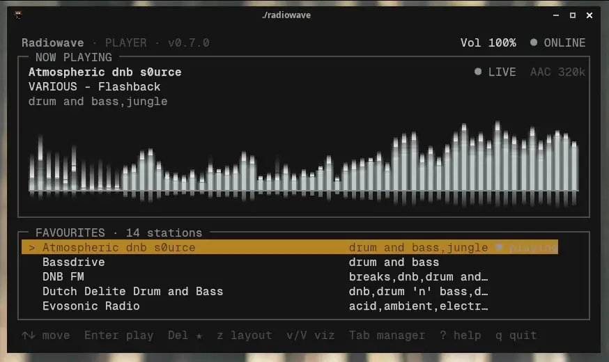
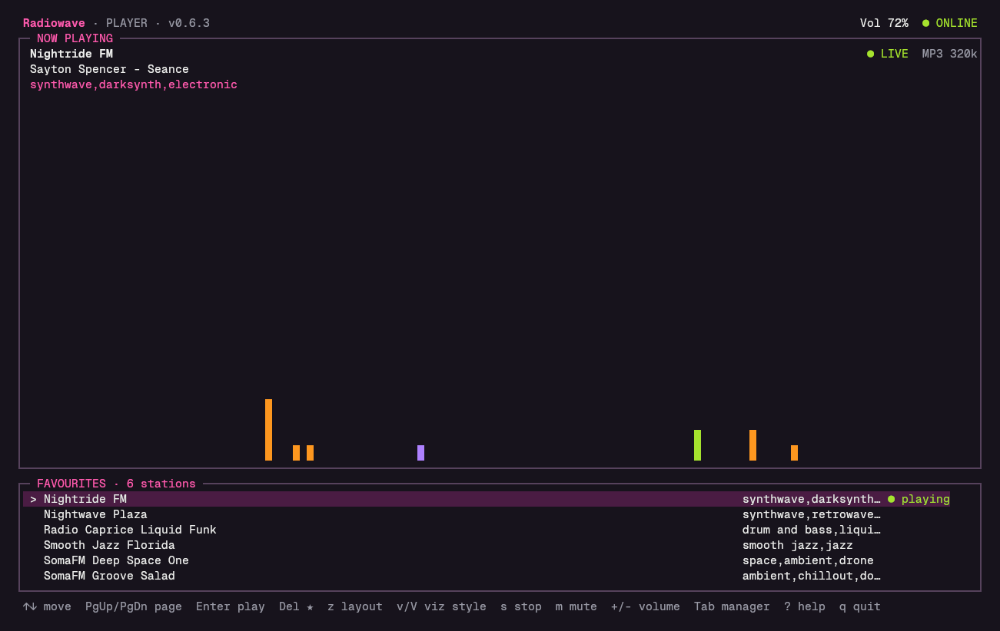
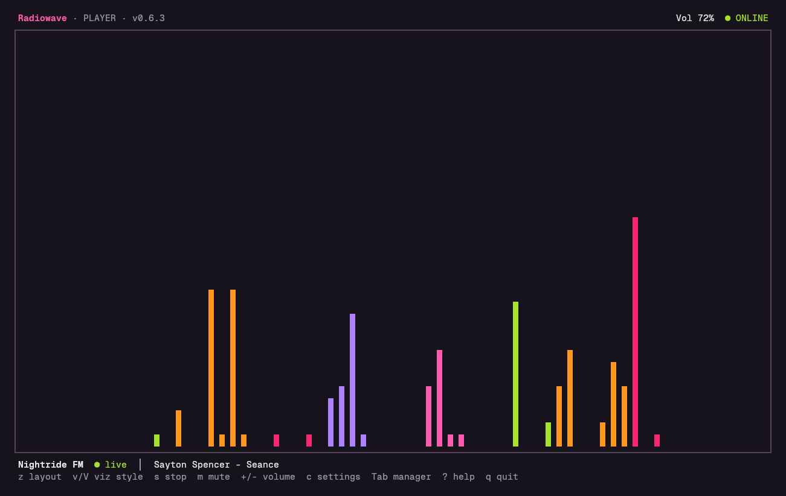
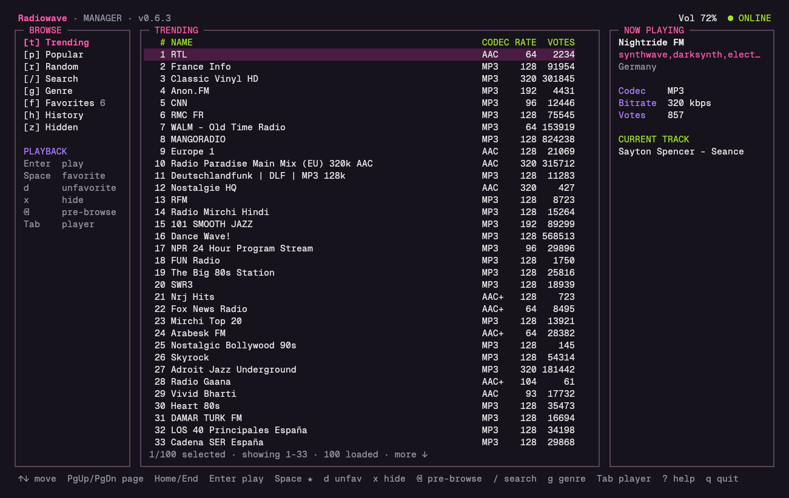
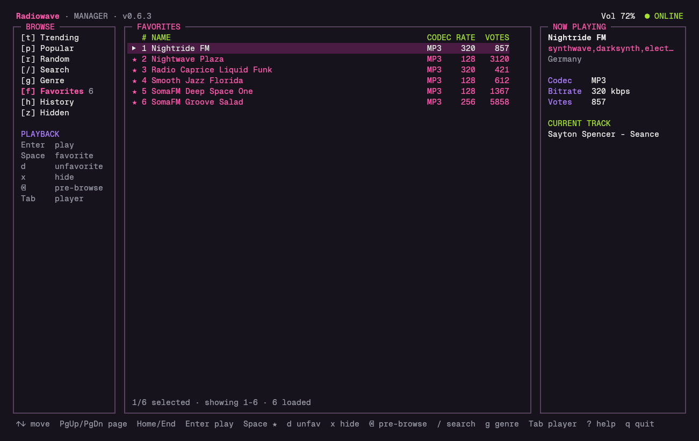
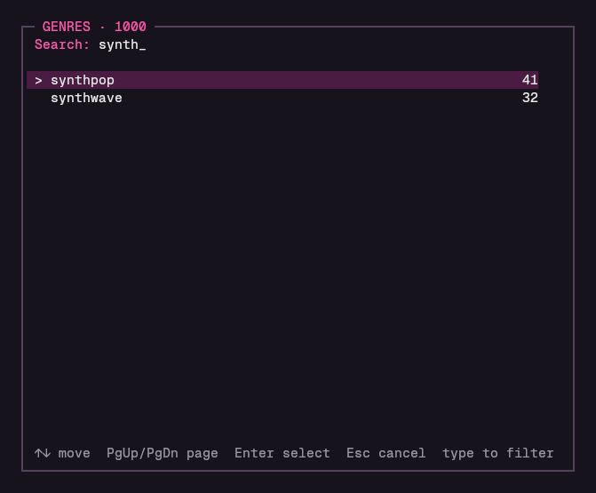
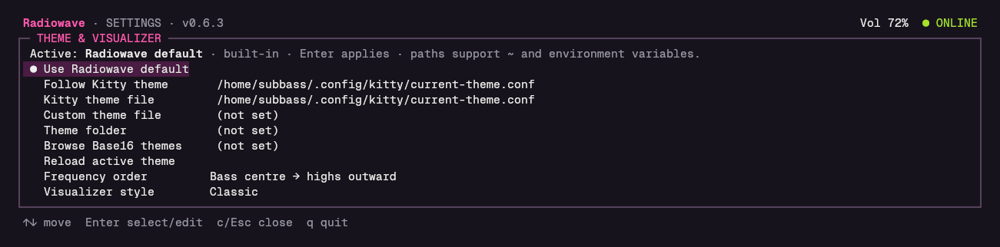

# Radiowave

A terminal-native internet radio player and discovery tool for Linux.

Radiowave feels closer to a dedicated radio appliance than a general music
player. It has two pages that share one global playback state:

- **Player** — the listening screen. Shows what's playing, a full-width
  audio-reactive visualizer, and your favourites as a playlist.
- **Manager** — station discovery: trending, popular, random, search, exact
  genre tags, favourites, history and hidden stations, all backed live by
  [Radio Browser](https://www.radio-browser.info/).

Switching pages (`Tab`) never interrupts playback — you can browse the
Manager for several minutes auditioning a station before deciding whether to
favourite it.

<p align="center">
  <a href="images/radiowave_rgba_vis.mp4"></a>
</p>

**Yes, that's a terminal.** In Kitty, Radiowave's pixel visualizers draw
real 32-bit RGBA frames at 60 fps, alpha-blended straight onto a translucent
terminal background — no character cells involved.
([Full-quality clip](images/radiowave_rgba_vis.mp4).)

## Screenshots

| | |
|---|---|
|  |  |
| Player · Normal layout | Player · Visual layout |
|  |  |
| Manager · live Trending from Radio Browser | Manager · Favourites |
|  |  |
| Genre picker — live-filters the tag catalogue | Settings — themes and visualizer |

If [`cava`](https://github.com/karlstav/cava) is installed, the visualizer is
real audio analysis of whatever is playing through your default audio
device. Without `cava` on `PATH`, it falls back to clearly-labelled demo
waveforms. Ten character-cell visualizer styles are available (`v`/`V` to
cycle): Classic, Mirrored, Blocks, Peaks, VU, Oscilloscope, Waterfall,
Plasma, Tunnel, and Ribbons.

In Kitty (or any terminal with the Kitty graphics protocol), eleven **pixel
styles** join the cycle and render real RGBA graphics at 60 fps with alpha
blending:

- **Neon** — glowing gradient bars with falling peak caps, phosphor trails,
  sparks thrown from the tallest bars on every beat, and a floor reflection
  that ripples with the bass.
- **Nebula** — a Milkdrop-style feedback swirl around a beat-reactive
  spectrum ring; beat sparks smear into comet streaks.
- **Spectrogram** — scrolling frequency-over-time heat map in your theme's
  colours, quiet bins left transparent.
- **Fire** — the classic demoscene fire, fed by the spectrum along the
  bottom, with embers on every beat.
- **Warp** — a starfield flight: bass sets the speed, beats kick into
  hyperspace streaks, and every star twinkles with its frequency band.
- **Wormhole** — a demoscene texture tunnel whose wall is the music:
  spectrum around it, time along it.
- **Copper** — Amiga copper bars, one per band, bobbing and overlapping.
- **Ridgeline** — the *Unknown Pleasures* plot: spectrum ridges receding up
  the screen.
- **Horizon** — a synthwave sunset with spectrum mountains and a scrolling
  neon grid.
- **Lava** — a lava lamp of metaballs that swell and merge with the music.
- **LED** — a segmented hardware analyser in the style of Winamp's classic
  skin, with falling peak segments.

Other terminals and tmux keep the character styles. `--gfx=auto|shm|direct|off` picks the transport and
`--pixel-scale=N` the pixel size (default 2×2 screen pixels).

The Player scales all the way down to a practical 24×4 mini player, and up
to a large Visual layout that gives nearly the entire window to the graph.

## Requirements

- Linux terminal with true-colour support. Kitty is ideal.
- A terminal at least 24 columns by 4 rows for the mini player. Manager,
  Help and Settings require 64×12.
- Go 1.23+ to build from source.
- `mpv` for playback.
- `cava` (optional) for a real audio spectrum instead of demo waveforms.
- Internet access for Radio Browser.

On Manjaro/Arch:

```bash
sudo pacman -S go mpv cava
```

## Build and install

```bash
cd src/radiowave-src
./install.sh
```

This installs `radiowave` to `~/.local/bin/radiowave`. Make sure that
directory is on your `PATH` (most distros add it by default for login
shells).

Or build locally from the project root (also recreates the root executable
symlink):

```bash
make build
./radiowave
```

```bash
radiowave --version   # or -V / -v
radiowave --help      # or -h
```

## Controls

### Both pages

| Key | Action |
| --- | --- |
| `Tab` | Switch between Player and Manager |
| `s` | Stop playback |
| `m` | Mute/unmute |
| `+` / `-` | Volume |
| `?` | Help overlay |
| `c` | Colour theme settings |
| `q` | Quit |

### Player

| Key | Action |
| --- | --- |
| `↑` / `↓`, `j` / `k`, `PgUp`/`PgDn`, `Home`/`End` | Move favourite selection |
| `Enter` | Play the highlighted favourite |
| `Del` | Remove the highlighted favourite |
| `z` | Cycle layout: Normal → Visual → Compact → Mini |
| `v` / `V` | Next / previous visualizer style |

### Manager

| Key | Action |
| --- | --- |
| `↑` / `↓`, `j` / `k` | Move selection |
| `Home` / `End` | First / last loaded station |
| `PageUp` / `PageDown` | Move by one visible page |
| `Enter` | Play the selected station (normal playback, not a timed preview) |
| `Space` | Toggle favourite |
| `x` | Hide station. In the Hidden view, restores it |
| `Backspace` | Return to the station that was playing before you started browsing |
| `t` / `p` / `r` | Trending / Popular / Random |
| `/` | Search station names |
| `g` | Genre picker — live-filter Radio Browser's tag catalogue |
| `f` / `h` / `z` | Favourites / History / Hidden stations |

## Persistence and resume

Playback state is saved immediately on every play/stop/volume/mute/layout/
visualizer change, not only on a clean shutdown. If Radiowave was playing a
station when it last exited — including an unclean exit — the next launch
reconnects to that station automatically. If you explicitly stopped playback
before quitting, the next launch stays stopped.

Radiowave stores its library at `$XDG_CONFIG_HOME/radiowave/library.json`
(or `~/.config/radiowave/library.json`). Favourites are stored as local
station snapshots, so a favourite is not lost merely because its Radio
Browser directory entry later changes or disappears.

## Colour themes

Press `c` from either page to open Settings and pick a palette without
interrupting playback: the built-in default, one that follows your Kitty
terminal theme live, a custom theme file (Kitty, Radiowave semantic
key/value, Base16/Base24 YAML, or generated i3 Base16), or a live-filtering
browser over a folder of theme files.

[Tinted Theming's `schemes` repo](https://github.com/tinted-theming/schemes)
is a good source of Base16/Base24 files — clone it and point the theme
folder browser at its `base16` directory.

## Architecture

See [`src/radiowave-src/architecture.md`](src/radiowave-src/architecture.md)
for the technical layout: the Radio Browser client, the persistent mpv/IPC
player, atomic local storage, the true-colour TUI renderer, theme handling,
and the cava-backed visualizer pipeline.

## Roadmap

See [`radiowave_project.md`](radiowave_project.md) for the full product
direction, and [`src/radiowave-src/CHANGELOG.md`](src/radiowave-src/CHANGELOG.md)
for release notes.

## License

No license has been chosen yet for this project.
